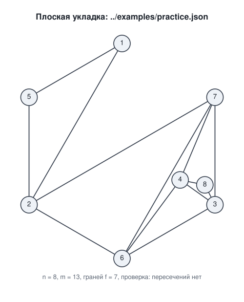
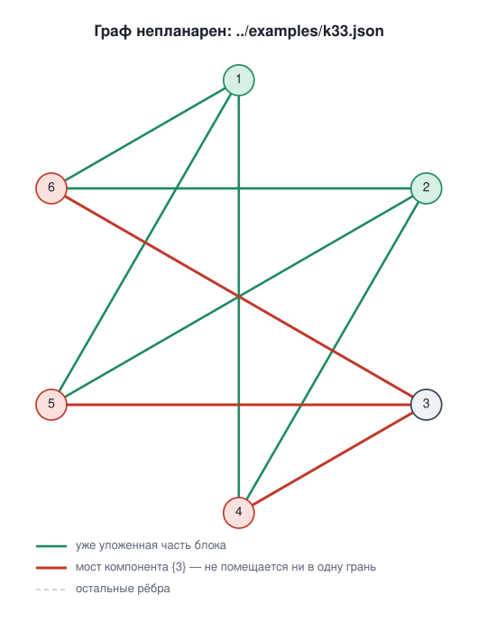

# graph-planarity

Задание 6 по дополнительным главам теории графов: для заданного графа
проверить планарность одним из алгоритмов комбинаторной укладки и, если
граф планарен, нарисовать его с помощью геометрической укладки.

- **Комбинаторная укладка** — алгоритм Демукрона. Результат: вердикт,
  система вращений и список граней.
- **Геометрическая укладка** — алгоритм Тутте (барицентрическое вложение).
  Результат: координаты вершин и рисунок прямыми отрезками без пересечений.
- **Визуализация** своя, SVG собирается как текст, без Graphviz.
  Дополнительно выгружается DOT-файл с теми же координатами.

Внешних зависимостей нет — только стандартная библиотека Python 3.8+.



## Запуск

```bash
cd src
python -m graphplanar --edges ../examples/practice.json --svg ../examples/practice.svg
```

Граф задаётся JSON-файлом — списком рёбер или объектом, если нужны
изолированные вершины:

```json
[[1, 2], [2, 3], [3, 1]]
{"vertices": [1, 2, 3, 4], "edges": [[1, 2], [2, 3], [3, 1]]}
```

Параметры:

| параметр | что делает |
|---|---|
| `--edges FILE` | граф из JSON-файла |
| `--demo NAME` | готовый пример, список — `--list-demos` |
| `--svg FILE` | записать рисунок |
| `--dot FILE` | записать DOT-файл |
| `--steps` | показать каждый шаг алгоритма Демукрона |
| `--tutte-only` | рисунок Тутте без последующего раздвигания вершин |

Пример вывода для планарного графа — в `examples/practice.txt`, для
непланарного — в `examples/k33.txt`.

## Как устроена проверка

Алгоритм Демукрона работает только с двусвязными графами, поэтому сначала
граф разбивается на части (как на слайде «Общая схема»):

1. **Компоненты связности** укладываются по отдельности.
2. **Блоки** (компоненты двусвязности) находятся алгоритмом Хопкрофта —
   Тарьяна. Граф планарен тогда и только тогда, когда планарен каждый блок.
   Мост (блок из одного ребра) планарен всегда.
3. **Каждый блок с циклом** проверяется алгоритмом Демукрона.

Перед этим печатается необходимое условие Эйлера `m ≤ 3n − 6`. Вердикт
выносит сам алгоритм: условие Эйлера необходимое, но не достаточное — у
K3,3 `9 ≤ 12`, а граф непланарен.

### Алгоритм Демукрона

Пусть H — уже уложенный подграф. **Мост** относительно H — это либо ребро
не из H с обоими концами в H, либо компонента связности графа G − H вместе
с рёбрами, ведущими в H. Вершины моста, лежащие в H, — **контактные**.

1. Найти цикл, уложить его — получаются две грани.
2. Пока уложены не все рёбра:
   - найти все мосты и для каждого — грани, на границе которых лежат все
     его контактные вершины;
   - если какому-то мосту не подходит ни одна грань — **граф непланарен**;
   - если есть мост с единственной подходящей гранью — уложить его туда,
     иначе уложить любой мост в любую подходящую грань;
   - уложить мост — провести в грани цепь между двумя его контактными
     вершинами; грань делится на две.

Пример разбора K3,3 (`--steps`):

```
исходный цикл: 1 – 4 – 2 – 5
шаг 1: компонента {3, 6}, контактные вершины [1, 2, 4, 5], подходящих граней 2, цепь 1 – 6 – 2
НЕ УДАЛОСЬ: компонента {3} с контактными вершинами [4, 5, 6]
не помещается ни в одну грань текущей укладки:
  (1 – 4 – 2 – 6)
  (2 – 5 – 1 – 6)
  (5 – 2 – 4 – 1)
```

Вершине 3 нужно видеть вершины 4, 5 и 6 из одной грани, а такой грани нет.

### Система вращений

Грани хранятся как циклические списки вершин с согласованной ориентацией:
каждое ребро входит в две грани в противоположных направлениях. Отсюда
восстанавливается система вращений — циклический порядок соседей каждой
вершины.

Соглашение об обходе граней: следующая дуга после (a, b) — это (b, c), где
c идёт в списке вращения вершины b сразу за a.

Укладки блоков склеиваются в точках сочленения: списки вращения вершины из
разных блоков записываются подряд. Это соответствует тому, что один блок
кладётся в грань другого, и планарности не нарушает.

Результат проверяется формулой Эйлера `n − m + f = 2` для каждой компоненты.

## Как строится рисунок

**Теорема Тутте.** Если планарный граф 3-связен и вершины одной его грани
закреплены на выпуклом многоугольнике, то, поставив каждую остальную
вершину в центр масс её соседей, получим плоский рисунок прямыми отрезками.
Координаты находятся из системы линейных уравнений
`deg(v) · p(v) = Σ p(u)`, которая решается методом Гаусса.

Произвольный планарный граф 3-связным не является, поэтому перед
применением Тутте граф достраивается, не нарушая укладки:

1. **До двусвязного.** Пока есть точка сочленения v, в её списке вращения
   ищутся два соседних соседа u и w из разных блоков. Угол u – v – w лежит
   в одной грани, поэтому ребро [u, w] проводится по этой грани без
   пересечений. После этого каждая грань ограничена простым циклом.
2. **Внешняя грань** закрепляется на правильном многоугольнике.
3. **Триангуляция.** В каждую внутреннюю грань длиннее трёх ставится
   вспомогательная вершина, соединённая со всеми вершинами грани.

Получается триангуляция диска с выпуклой границей, а для неё
барицентрическое отображение взаимно однозначно (теорема Тутте в
обобщении Флоатера). После решения системы вспомогательные вершины и
рёбра убираются.

**Выбор внешней грани.** Тутте даёт плоский рисунок при любой внешней
грани, но читаемость сильно зависит от выбора. Программа пробует разные
грани и оставляет рисунок, где вершины дальше всего друг от друга и от
чужих рёбер.

**Раздвигание.** У Тутте вершины в глубине рисунка часто сжаты в кучку.
Поэтому после него вершины раздвигаются силовым методом, но каждое
перемещение принимается, только если рёбра вершины ни с чем не
пересекаются и она остаётся внутри внешнего многоугольника. Планарность
сохраняется на каждом шаге, а результат берётся, только если самый тесный
зазор не уменьшился. Для компонент больше 40 вершин этот шаг пропускается
из-за времени; флаг `--tutte-only` отключает его вовсе.

### Проверка рисунка

Каждый рисунок проверяется отдельно от алгоритма: никакие две вершины не
совпадают, рёбра без общих концов не пересекаются и не касаются, ни одна
вершина не лежит на чужом ребре. Сравнение ведётся по синусу угла, а не по
площади треугольника: у Тутте вершины могут стоять на расстоянии 10⁻⁵
друг от друга, и абсолютный допуск там дал бы ложные срабатывания.

## Непланарный граф

Для непланарного графа рисуется, на каком шаге алгоритм остановился:
зелёным — уже уложенная часть блока, красным — мост, которому не нашлось
грани.



## Сравнение с Graphviz

DOT-файл содержит координаты с восклицательным знаком, поэтому Graphviz
рисует ровно ту укладку, что построила программа:

```bash
neato -n -Tsvg examples/practice.dot -o practice-graphviz.svg
```

## Примеры

| файл | что это |
|---|---|
| `examples/practice.json` | граф из задачи 8а практики 1 — вход |
| `examples/practice.txt` | вывод программы: блоки, шаги, вращения, грани |
| `examples/practice.svg` | плоская укладка |
| `examples/practice.dot` | она же в DOT с координатами |
| `examples/k33.json`, `k33.txt`, `k33.svg`, `k33.dot` | K3,3: разбор непланарного графа по шагам |
| `examples/cube.svg` | куб |
| `examples/blocks.svg` | граф с точками сочленения и двумя компонентами |
| `examples/k5.svg`, `examples/petersen.svg` | K5 и граф Петерсена |

Граф из задачи 8а планарен, хотя на рисунке в задании его рёбра
пересекаются: пересечения были свойством рисунка, а не графа.

## Тесты

```bash
PYTHONPATH=src python -m unittest discover -s tests -v
```

19 тестов: блоки и точки сочленения, шаги Демукрона, известные планарные и
непланарные графы (K5, K3,3, K6, Петерсен, подразделение K3,3), формула
Эйлера, достройка до двусвязности, отсутствие пересечений на рисунках
демо-графов и случайных планарных графов. Если установлен NetworkX,
вердикт дополнительно сверяется с `networkx.check_planarity` на 400
случайных графах; без него этот тест пропускается.

## Структура

```
src/graphplanar/
    graph.py       структура графа
    blocks.py      компоненты связности, блоки, точки сочленения
    demoucron.py   алгоритм Демукрона
    embedding.py   система вращений, обход граней, достройка до двусвязного
    tutte.py       алгоритм Тутте и выбор внешней грани
    relax.py       раздвигание вершин с сохранением планарности
    geometry.py    проверка рисунка на пересечения
    render.py      отрисовка в SVG
    dot.py         экспорт в DOT
    demos.py       готовые графы
    cli.py         командный интерфейс
```
